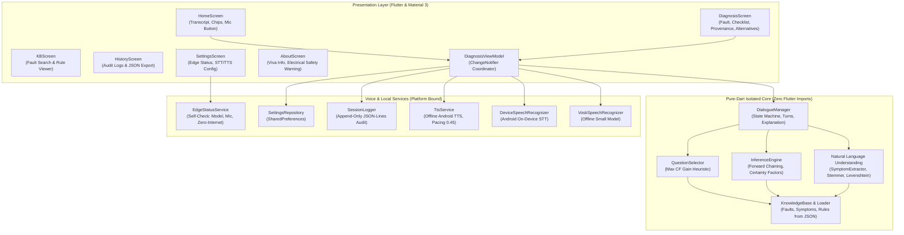
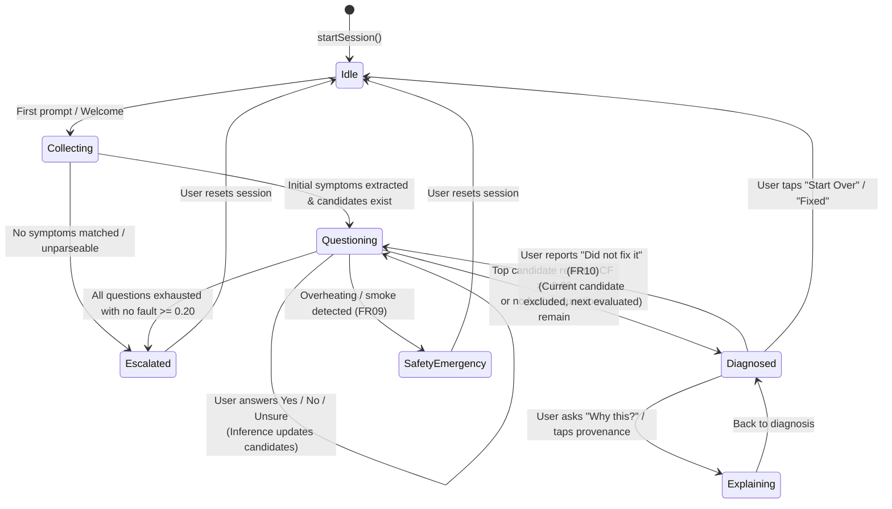
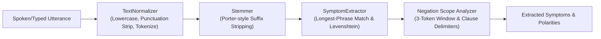
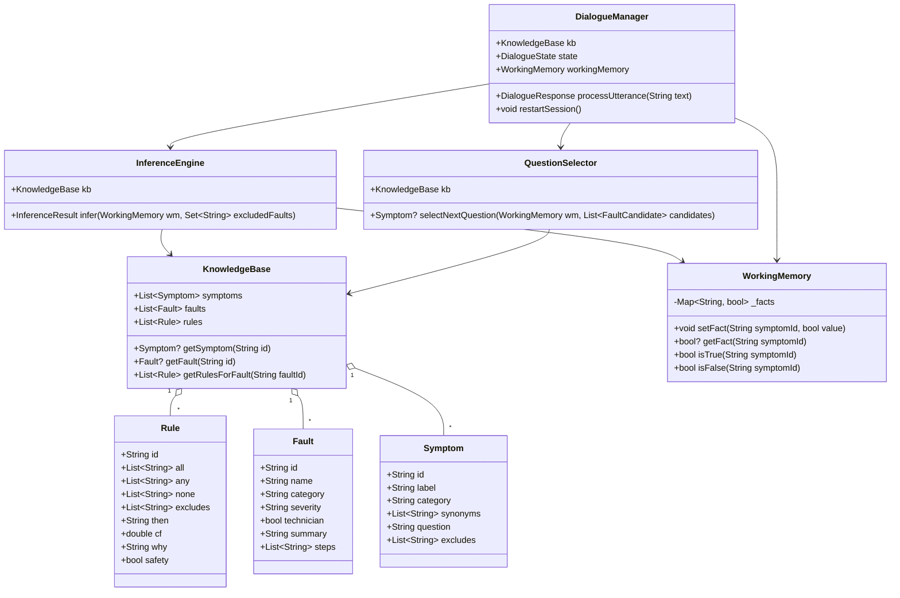

# Architecture & Technical Design Specification

**Project:** PrinterDoc — Edge Expert System for Printer Fault Diagnosis  
**Target:** Android (API 24+) | Offline-first Edge Architecture  
**Author:** HND Final-Year Student Project  

---

## 1. System Overview & Layered Architecture

PrinterDoc is engineered using a clean, layered architecture with a strict boundary between platform-dependent presentation/voice services and a pure-Dart core computational engine.



---

## 2. Pure-Dart Core Isolation Principle

To guarantee testability, maintainability, and clean separation of concerns, the computational core located in:
- `lib/knowledge/`
- `lib/engine/`
- `lib/nlu/`
- `lib/dialogue/`

contains **zero imports from `package:flutter/...`**. All data structures are standard Dart (`dart:core`, `dart:collection`, `dart:math`, `dart:convert`). This enables sub-millisecond unit test execution without spinning up Flutter test harnesses or Android emulators.

---

## 3. Dialogue Manager State Machine

The interaction flow is managed by a deterministic finite state machine implemented in `DialogueManager`.



### State Definitions & Transitions:
1. **Idle:** System initialized, waiting for user trigger.
2. **Collecting:** Initial open-ended symptom elicitation (*"What seems to be the problem with your printer?"*).
3. **Questioning:** System targets the highest-information follow-up symptom and prompts the user with binary/clarification questions (*"Does the printer fail to pull paper in from the tray?"*).
4. **Diagnosed:** A conclusive candidate exceeds the confidence threshold ($CF \ge 0.60$) or maximum information gain has concluded. Displays repair steps.
5. **Explaining:** The user invokes *"Why?"* or inspects the audit trail, prompting rule contributions and evidence.
6. **SafetyEmergency:** Immediate override triggered when critical thermal/electrical hazard symptoms appear (FR09).
7. **Escalated:** Safe fallback when symptoms are contradictory or cannot be resolved above $CF = 0.20$.

---

## 4. Forward-Chaining Inference & Certainty Algebra

The inference engine executes data-driven forward chaining using certainty factor algebra adapted from Shortliffe & Buchanan's MYCIN expert system.

```mermaid
flowchart TD
    Start([User Utterance / Answer]) --> NLU[Extract Symptoms & Polarities]
    NLU --> AssertWM[Update WorkingMemory: symptomId -> bool]
    AssertWM --> SafetyCheck{Is 'overheating' asserted true?}
    SafetyCheck -- Yes --> SafetyTrigger[Short-circuit: Fault F20, CF = 1.0]
    SafetyCheck -- No --> MatchRules[Evaluate Rule Antecedents]

    MatchRules --> EvalConds{Check Conditions:<br/>- all satisfied?<br/>- any satisfied?<br/>- none absent/false?<br/>- excludes absent/false?}
    EvalConds -- No --> NextRule[Skip Rule]
    EvalConds -- Yes --> ComputeCF[Calculate Rule CF Contribution]

    ComputeCF --> CombineCF[Combine with Existing Fault CF:<br/>CF_new = CF_old + CF_rule * (1 - CF_old)]
    CombineCF --> MoreRules{More Rules?}
    MoreRules -- Yes --> MatchRules
    MoreRules -- No --> RankCandidates[Rank Candidates by CF descending]

    RankCandidates --> ThresholdCheck{Top candidate CF >= 0.60<br/>OR questions exhausted?}
    ThresholdCheck -- Yes --> Conclude[Diagnose Top Fault Candidate]
    ThresholdCheck -- No --> SelectQ[QuestionSelector: Find Next Best Question]
```

### Mathematical Certainty Factor Algebra:
- **Rule Firing:** A rule fires if all preconditions in its `all` list are confirmed in working memory, at least one in `any` is confirmed (if specified), no symptoms in `none` are confirmed true, and no symptoms in `excludes` are confirmed true.
- **Parallel Certainty Combination:** When multiple independent rules $R_1, R_2, \dots, R_k$ conclude the same fault hypothesis $h$ with positive certainty factors $CF_1, CF_2$:
  $$CF_{comb}(h) = CF_{prev} + CF_{new} \cdot (1 - CF_{prev})$$
- **Bounded Monotonicity:** As evidence accumulates, certainty monotonically increases toward 1.0 without ever exceeding 1.0:
  $$\lim_{k \to \infty} CF(h) = 1.0$$
- **Pruning Thresholds:**
  - Candidates with $CF < 0.20$ are pruned as non-viable.
  - Candidates with $CF \ge 0.60$ qualify for confident diagnosis.

---

## 5. Natural Language Understanding (NLU) Pipeline

The NLU subsystem is deterministic and lightweight, requiring no neural models or tokenizers:



1. **Text Normalization:** Converts strings to lowercase, strips punctuation while retaining alphanumeric tokens and contractions, collapses repeated whitespace.
2. **Stemming:** Applies step-by-step suffix stripping (e.g. `-ing`, `-ed`, `-es`, `-s`, `-tion`, `-ment`) to match root word variations (*"jamming"* $\to$ *"jam"*, *"streaks"* $\to$ *"streak"*).
3. **Levenshtein Fuzzy Matching:** Supports fuzzy token comparison with adaptive distance:
   - Tokens with length $\le 3$: exact match only.
   - Tokens with length $4 \dots 6$: Levenshtein distance $\le 1$.
   - Tokens with length $\ge 7$: Levenshtein distance $\le 2$.
4. **Negation Detection:** Inspects up to 3 tokens preceding a matched phrase for negative indicators (`no`, `not`, `dont`, `doesnt`, `isnt`, `cant`, `cannot`, `never`, `without`).
5. **Clause Boundary Delimitation:** Tokens such as `but`, `however`, `although`, `though`, and `yet` isolate negation scope, preventing negative modifiers from leaking into contrastive clauses (*"not jammed but will not feed"*).

---

## 6. Class Hierarchy & Entity Relationships



---

## 7. Voice Subsystem & Half-Duplex Coordination

To prevent acoustic feedback (where speech synthesis is picked up by the microphone recognizer), the audio services operate in a synchronized **half-duplex mode**:

```
+-------------------------------------------------------------+
|                     Half-Duplex Coordinator                 |
|                                                             |
|   1. System speaks (TTS active)                             |
|      --> Mic recognizer explicitly PAUSED                   |
|      --> Mic button UI indicates muted speaker state        |
|                                                             |
|   2. TTS Completes (`await tts.speak()`)                    |
|      --> 350 ms acoustic settling delay                     |
|      --> Auto-listen resumes (if enabled in Settings)       |
|      --> Mic recognizer activated                           |
|      --> Mic button UI pulses green                         |
+-------------------------------------------------------------+
```

- **Pluggable STT Interface (`SpeechRecognizerService`):**
  - `VoskSpeechRecognizer`: Offline small acoustic model running locally on-device.
  - `DeviceSpeechRecognizer`: Android native speech recognizer configured with `onDevice: true`.
- **Offline TTS Engine (`TtsService`):**
  - Native Android `TextToSpeech` service configured for `en-US`.
  - Pacing defaulted to $0.45$ for clear step-by-step diagnostic instructional cadence.
  - Startup self-check alerts the user if language data requires offline voice download in Android Settings.

---

## 8. Persistence & Audit Logging

- **`SessionLogger`:** Diagnostic sessions are logged to an append-only JSON-lines (`.jsonl`) file in the application's local documents directory (`diagnostics_history.jsonl`). Corrupted lines are skipped gracefully, sessions are retrieved in reverse-chronological order, and audit records can be exported directly to clipboard or file.
- **`SettingsRepository`:** User preferences (voice rate, STT engine choice, auto-listen toggle, Vosk model path) are persisted via `shared_preferences`.
